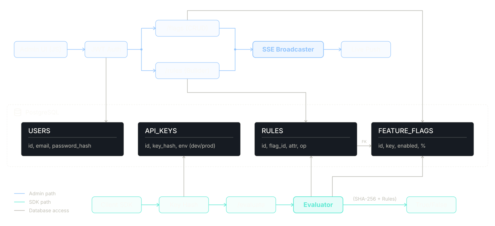

> A production-grade zero-dependency feature flag engine.

---

| Layer             | Technology                                     |
|-------------------|------------------------------------------------|
| Language          | Python 3.14+, HTML5, Raw CSS3, Vanilla ES6+ JS |
| Backend API       | FastAPI                                        |
| Database Tools    |                                                |
| Database Deploy   | PostgreSQL                                     |
| Infra and Testing | Docker, `pytest`, GitHub Actions CI            |
| Auth and Security | `bcrypt`, `PyJWT`, `secrets`, `hashlib`        |
| Config            | python-dotenv                                  |
| Deployment        |                                                |

---

## Architecture

---